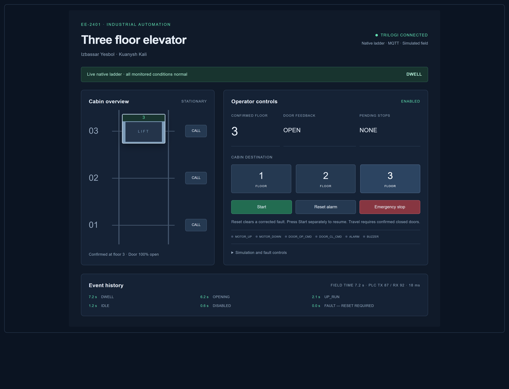
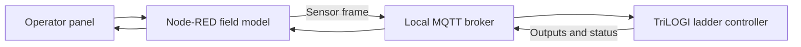

# Three-floor elevator

A simulated elevator controller built in i-TRiLOGI, with a Node-RED operator panel connected over local MQTT.

The ladder program handles floor requests, travel direction, the door sequence and latched faults. Node-RED simulates the cabin and door mechanics, sends sensor states to the PLC, and displays the PLC outputs. The running controller is the native TriLOGI program.

[Watch the demo](Presentation/Elevator_Live_Demo_1080p.mp4) · [Read the report](Final_Project_Report_EE2401_Yesbol_Kali.pdf) · [Presentation](Presentation/Elevator_Defence_EE2401.pdf)

## Run the demonstration

Use Windows with **Node.js 22+** and **i-TRiLOGI 7.5+ Educational** installed. The launcher searches for TriLOGI under `C:\TRiLOGI`.

1. Clone or download this repository and run `START_DEMO.bat`.
2. The first launch installs the pinned npm dependencies. Allow TriLOGI to run the connected project when prompted, or press **Ctrl+F9** in TriLOGI.
3. Open [the operator panel](http://127.0.0.1:1888/dashboard/elevator). Wait for **TRILOGI CONNECTED** and increasing TX/RX counters.
4. Press **Reset alarm**, wait for the fault to clear, then press **Start**. Select a destination.

Keep one instance of the connected PLC project running. Use `STOP_DEMO.cmd` to stop Node-RED and the local broker; close TriLOGI separately.

Detailed setup and reconnection notes: [START_HERE.md](START_HERE.md). Russian demonstration guide: [Defence_Guide_RU.md](Defence_Guide_RU.md).

## How it works

The standalone controller uses **15 digital inputs**, **6 digital outputs** and **68 ladder networks**. The connected project adds four communication networks around the same control logic. A normal cycle closes the door, travels to a requested floor, opens the door, waits five seconds and closes again. Door operations have an eight-second timeout; travel has a fifteen-second timeout.

Faults latch until conditions are corrected and Reset is pressed. Reset does not restart the elevator: Start is a separate action. The model includes obstruction, door jam, E-stop, sensor conflict and drive-fault controls for demonstrations.

## Project files

| Path | Contents |
| --- | --- |
| [TriLOGI_Projects/](TriLOGI_Projects/) | Standalone LD controller, request-memory bench, native test suite and connected MQTT project |
| [HMI_Node_RED/](HMI_Node_RED/) | Dashboard flow, simulated mechanics, local broker and dependency lockfile |
| [Design/](Design/) | I/O and engineering diagrams, FBD representation and MQTT mapping |
| [Evidence/](Evidence/) | Recorded test results, traces and screenshots |
| [Presentation/](Presentation/) | Slides, speaker notes, demonstration video and defence notes |
| [Source/](Source/) | Development generators and verification scripts; their original workspace assumptions are documented there |
| [I_O_List.csv](I_O_List.csv) | Input and output allocation |
| [Test_Results.csv](Test_Results.csv) | Nine native regression scenarios |

The report is available as [PDF](Final_Project_Report_EE2401_Yesbol_Kali.pdf) and [DOCX](Final_Project_Report_EE2401_Yesbol_Kali.docx). Download the whole repository before starting the demo; the launcher needs the surrounding directories.

## Verification and limits

The recorded native suite contains nine passing scenarios. The FBD equivalence record compares 68 networks over 5,931 scans. These are saved results, not a claim that every run on every machine has been tested. See [verification notes](docs/verification.md) for the evidence and scope.

- **LD runs in TriLOGI. FBD is a diagram representation**, with an equivalence check; there is no native FBD executable in this repository.
- **Intermediate-floor timing needs further work under load.** During a video-recording attempt, the field model stopped at position 2.05, outside the floor-two sensor zone, and raised `DOOR_FLT`. The included video demonstrates the successful 1 → 3 trip and fault-recovery sequence; it does not demonstrate that intermediate stop.
- The MQTT broker and Node-RED bind to localhost. This is a local teaching setup, not an internet-facing service.
- No physical lift was connected. The FMD1616-10 is an I/O design candidate; the simulator/Wx100 MQTT adapter is not a hardware MQTT implementation for that PLC. This project is not a certified lift controller.

## Authors

Izbassar Yesbol and Kuanysh Kali · EE-2401 · Industrial Automation course.

AI assistance was used during development and documentation. The report includes the disclosure and distinguishes executed tests, diagram checks and proposed hardware. The repository preserves those distinctions.
